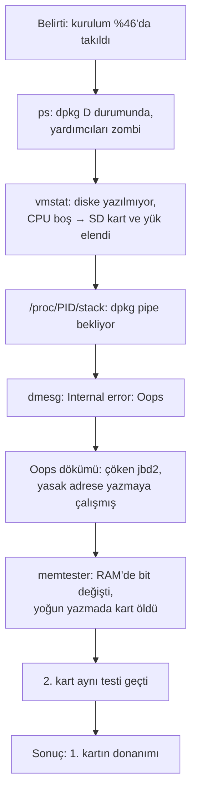

# PINE64: paket kurulumunda sistem donuyor

> [!IMPORTANT]
> **Tek cümlede**
> `apt install` sırasında PINE64 donuyordu. Suçlu apt, SD kart ya da yazılım değil, **1. PINE64 kartının RAM'i** çıktı. RAM arada bir biti yanlış hatırlıyor, kernel'in diske yazma görevlisi (`jbd2`) bozuk bilgiyle çalışınca çöküyor, sistem de kilitleniyor. Aynı SD kart, adaptör ve kabloyla 2. kart bütün testleri geçti.

| | |
|---|---|
| **Belirti** | Paket kurulumu %46'da takılıyor, sonra SSH ve ping de gidiyor |
| **Kök neden** | 1. kartın RAM'i (ya da RAM'i besleyen devre) yoğun yazmada hata yapıyor |
| **Çözüm** | Sunucu olarak 2. kart kullanılıyor, 1. kart deney kartı |
| **Süre** | 18 Kasım akşamı → 19 Kasım sabahı |

---

## 1. Önce kafada oturması gerekenler

Arıza tespitinin mantığı bu üç fikre dayanıyor.

### Bilgisayarın üç katı

| Kat | Ne | Bu olaydaki rolü |
|---|---|---|
| Programlar | `apt`, `dpkg`, `ssh`, `memtester` | İş isteyenler |
| Kernel | Linux'un çekirdeği, aracı | İşleri donanıma iletir. İçindeki `jbd2` diske yazmayı yönetir |
| Donanım | İşlemci, RAM, SD kart, güç | Asıl suçlu buradaydı (RAM) |

**Kural:** Programlar donanıma doğrudan dokunamaz, kernel'e söyler.

### RAM ve disk

- **Disk (SD kart):** Dolap. Kalıcı ama yavaş.
- **RAM:** Masa. Hızlı ama elektrik gidince silinir.
- **İşlemci:** Sadece masadakiyle çalışır. Her şey önce RAM'e gelir.
- **Okuma** (disk → RAM) ve **yazma** (RAM → disk) aslında **kopyalama**. Kaynak yerinde kalır.

### Paket kurulumunun akışı


- **apt** indirir, **dpkg** açıp "bu dosya nereye?" kararını verir, **jbd2** diske yazar.
- jbd2 sadece **yazma** yolunda çalışır. Diske yazacak her şey, istisnasız ondan geçer.
- jbd2 çökerse diske yazmak isteyen herkes sonsuza kadar bekler. SSH girişi de diske küçük bir kayıt yazar, o yüzden yeni bağlantı da açılamaz.

---

## 2. Tespit yolu, bir bakışta



---

## 3. Adım adım ne yaptık

### Adım 1: Belirti

```bash
apt install -y htop git vim curl dnsutils iw ethtool iperf3
```

- `apt install`: Paket kurar.
- `-y`: Onay sorusuna otomatik "evet" der.
- `htop git vim ...`: Kurulacak paketler.

Kurulum 10 dakikadan uzun süre %46'da kaldı. Önceki gün de `network-manager` kurulurken benzer bir donma olmuş, güç kesilerek kurtarılmıştı.

> [!WARNING]
> **Gücü kesmek son çare**
> Paket kurulurken gücü kesmek paket veritabanını yarım bırakabilir. Önce ikinci bir SSH oturumundan bakmak gerekir.

---

### Adım 2: Süreçlere bak (kim ne yapıyor?)

```bash
ps -eo pid,stat,etime,cmd | grep -E 'apt|dpkg|http' | grep -v grep
```

- `ps`: Çalışan süreçleri listeler.
- `-e`: Bütün süreçler.
- `-o` `pid,stat,etime,cmd`: Sadece PID, durum, çalışma süresi ve komut sütunları.
- `grep` `-E` `'apt|dpkg|http'`: Bu kelimelerden birini içeren satırlar (`-E` = genişletilmiş regex, `|` = veya).
- `grep` `-v` `grep`: grep'in kendi satırını çıkarır (`-v` = eşleşmeyenleri göster).

```text
   1907 S+   19:12 apt install -y htop git vim ...
   1983 Ds+  10:54 /usr/bin/dpkg ... --unpack ...
   2232 S+   10:40 dpkg-deb --fsys-tarfile .../vim-runtime_...deb
   2233 Z+   10:40 [dpkg-deb] <defunct>
   2234 Zl+  10:40 [dpkg-deb] <defunct>
```

| Durum harfi | Anlamı |
|---|---|
| `S` | Uyuyor, normal bekleme |
| `D` | **Kesilemeyen bekleme**. `Ctrl+C` ve `kill` bile işlemez |
| `Z` | Zombi. Ölmüş, ebeveyni çıkışını henüz toplamamış |
| `l` | Çok iş parçacıklı |

> [!NOTE]
> **Ne öğrendik?**
> İndirme bitmiş, takılan yer paket açma (`--unpack`). dpkg `D` durumunda bekliyor, kutuyu açan yardımcılar (`dpkg-deb`) ölmüş. **dpkg bekleyen taraf, suçlu değil.** Suçlu olsaydı kendisi çökerdi.

---

### Adım 3: Disk yavaş mı, yoksa hiç yazılmıyor mu?

```bash
vmstat 2 5
```

- `vmstat`: Bellek, süreç ve disk G/Ç özetini satır satır verir.
- `2 5`: 2 saniyede bir ölç, 5 kez.

```text
 r  b   swpd   free    buff  cache   si so  bi  bo   in  cs us sy  id wa
 0  0      0 1427284  18304 377568    0  0   0   0  313 200  0  0 100  0
```

| Sütun | Anlamı | Değer |
|---|---|---|
| `b` | Disk bekleyen süreç sayısı | 0 |
| `bo` | Diske yazılan blok/sn | **0** |
| `wa` | CPU'nun diski bekleyerek geçirdiği % | 0 |
| `id` | CPU boşta % | 100 |

> [!NOTE]
> **Ne öğrendik?**
> Kart yavaş yazıyor olsaydı `bo` sıfırdan büyük olurdu. Hiç yazılmıyor ve CPU boş. **SD kartın yavaşlığı ve işlemci yükü elendi.** dpkg diski değil, başka bir şeyi bekliyor.

---

### Adım 4: dpkg tam olarak neyi bekliyor?

Kernel her süreç için `/proc/<PID>/` altında canlı bir bilgi klasörü tutar. Bu dosyalar diskte değil, kernel okunurken üretir.

```bash
cat /proc/1983/stack
```

- `cat`: Dosyayı ekrana basar.
- `/proc/1983/stack`: 1983 numaralı sürecin (dpkg) kernel içinde takıldığı fonksiyon zinciri. PID'i Adım 2'deki `ps` çıktısının ilk sütunundan aldık.

```text
[<0>] anon_pipe_read+0x4c/0x3a0
[<0>] vfs_read+0x2e4/0x310
...
```

```bash
ps -o pid,ppid,stat,wchan:32,cmd -p 1983,2232,2233,2234
cat /proc/2232/stack
```

- `-o` `pid,ppid,stat,wchan:32,cmd`: `ppid` = ebeveyn PID, `wchan:32` = kernel'de beklenen fonksiyon (32 karakter genişlikte).
- `-p` `1983,2232,...`: Sadece bu süreçleri göster.

```text
   PID  PPID STAT WCHAN           CMD
  1983  1907 Ds+  anon_pipe_read  /usr/bin/dpkg ...
  2232  1983 S+   do_wait         dpkg-deb --fsys-tarfile ...vim-runtime...
  2233  2232 Z+   -               [dpkg-deb] <defunct>
  2234  2232 Zl+  -               [dpkg-deb] <defunct>
```

> [!NOTE]
> **Ne öğrendik?**
> Bir montaj hattı var: `dpkg-deb` (2232) paketi açıyor, sıkıştırma çözücüleri (2233, 2234) veriyi çözüyor, pipe üzerinden dpkg'ye (1983) veriyor.
> - dpkg → `anon_pipe_read`: pipe'tan veri bekliyor
> - 2232 → `do_wait`: ölen çocuklarının çıkışını bekliyor
> - Çözücüler ölü
>
> Stack'te `mmc` ya da `ext4` yok, yani **SD kart bu beklemenin içinde değil**. Soru: Çözücüleri kim öldürdü?

---

### Adım 5: Kernel'in tutanak defterine bak

```bash
timeout 5 dmesg -T | grep -iE 'segfault|unhandled|oops|internal error|illegal|bus error|killed|blocked|voltage' | tail -20
```

- `timeout` `5`: Komut 5 saniyede bitmezse durdur. Sistem takılıysa terminal kilitlenmesin diye.
- `dmesg`: Kernel mesajlarını (RAM'deki halka tamponu) gösterir.
- `-T`: Zamanı okunur tarih/saat olarak yaz.
- `grep` `-iE`: `-i` büyük/küçük harf fark etmez, `-E` regex.
- `tail` `-20`: Son 20 satır.

```text
[Wed Nov 18 22:11:18 2026] Internal error: Oops: 000000009600004e [#1] SMP
```

> [!CAUTION]
> **Oops nedir?**
> Kernel'in **kendi kodunda** bir hataya düşmesi. Sıradan bir programın çökmesi değil, işletim sisteminin çekirdeği hata vermiş. Saat 22:11:18, paket açma işinin başladığı ana denk geliyor.

---

### Adım 6: Çökme dökümünü al ve oku

Sistem her an tamamen kilitlenebileceği için çıktı **RAM'e** yazıldı, karta değil.

```bash
timeout 5 dmesg -T | grep -B 15 -A 60 'Internal error' > /dev/shm/oops.txt
```

- `-B` `15`: Eşleşen satırdan **önceki** 15 satır. Asıl açıklama Oops satırının üstündedir.
- `-A` `60`: **Sonraki** 60 satır. Çalışan süreç ve fonksiyon zinciri burada.
- `/dev/shm/`: RAM üzerinde çalışan klasör. Karta hiç dokunmaz.

Bilgisayara çekmek için (Windows PowerShell'de):

```powershell
scp root@192.168.1.130:/dev/shm/oops.txt ~/Desktop/
```

Dökümün kritik satırları (sistem yeniden başlatıldıktan **128 saniye sonra** aynı çökme tekrar olmuştu):

```text
Unable to handle kernel write to read-only memory at virtual address ffff000000924000
  ESR = 0x000000009600004e
  FSC = 0x0e: level 2 permission fault
  CM = 0, WnR = 1
Internal error: Oops: 000000009600004e [#1] SMP
CPU: 2 UID: 0 PID: 166 Comm: jbd2/mmcblk0p1- Not tainted 6.18.63-current-sunxi64 #1
pc : __pi_memset_generic+0x16c/0x188
Call trace:
 __pi_memset_generic+0x16c/0x188
 jbd2_journal_commit_transaction+0x6e8/0x18d8
 kjournald2+0xac/0x208
```

| Satır | Türkçesi |
|---|---|
| `write to read-only memory` | Yazma yasak bir bellek adresine yazmaya çalışmış |
| `WnR = 1` | Hata bir **yazma** işleminde olmuş |
| `Comm: jbd2/mmcblk0p1-` | Çöken: SD kartın (`mmcblk0p1`) günlük görevlisi **jbd2** |
| `pc : __pi_memset_generic` | Bir bellek alanını sıfırlarken çökmüş |
| `jbd2_journal_commit_transaction` | Günlüğe kayıt işlerken |
| `Not tainted` | Kernel o ana kadar temizdi |

> [!NOTE]
> **Ne öğrendik?**
> jbd2 öldüğü için diske yazmak isteyen her şey kilitlendi. **İki donmanın da açıklaması bu.** İkinci çökmede apt hiç çalışmıyordu, yani **apt ve dpkg masum.**
>
> Ama jbd2'nin kendisi de büyük ihtimalle suçlu değil: Dünyadaki milyonlarca Linux'ta her saniye çalışan bir kod. Daha olası olan, elindeki adresin **RAM'de bozulmuş** olması. Yani soru: Bozuk bilgiyi kim üretti?

---

### Adım 7: Güvenli yeniden başlatma

Normal `reboot` takılı süreçleri bekleyip asılı kalabilir. Kernel'e doğrudan komut verildi:

```bash
echo 1 > /proc/sys/kernel/sysrq
echo s > /proc/sysrq-trigger
echo u > /proc/sysrq-trigger
echo b > /proc/sysrq-trigger
```

- `/proc/sys/kernel/sysrq`: Acil durum komutlarını açar (`1` = hepsi). Diske değil, kernel'in anlık ayarına yazılır.
- `s`: Bekleyen veriyi diske yaz (sync).
- `u`: Dosya sistemlerini salt okunur yap.
- `b`: Hemen yeniden başlat.

> [!WARNING]
> **jbd2 ölüyse sadece `b`**
> Günlük görevlisi çökmüşse `s` ve `u` da takılır, çünkü ikisi de diske yazmaya çalışır. O durumda doğrudan `echo b > /proc/sysrq-trigger`.

---

### Adım 8: Yarım kalan paketi toparla

```bash
dpkg --configure -a
dpkg --audit
```

- `--configure` `-a`: Yapılandırması yarım kalan **bütün** paketleri tamamla.
- `--audit`: Sorunlu paket var mı kontrol et. Boş çıktı = sorun yok.

`--audit`, çökme anında açılmakta olan `vim-runtime` için "half-installed" ve "missing list/md5sums" uyarısı verdi. Paket yeniden kurulmak yerine kaldırıldı:

```bash
dpkg --purge --force-remove-reinstreq vim-runtime
apt install -f
```

- `--purge`: Paketi ayar dosyalarıyla birlikte tamamen sil.
- `--force-remove-reinstreq`: "Yeniden kurulması gerekiyor" işaretli paketin silinmesine izin ver.
- `-f` (fix-broken): Bozuk bağımlılıkları onar. `-y` bilerek konmadı, ne yapacağını görmek için.

---

### Adım 9: RAM'i test et (memtester)

```bash
apt install -y memtester
memtester 1200M 1
```

- `memtester`: RAM'e desenler yazıp geri okur, bit bozuluyor mu bakar.
- `1200M`: Test edilecek bellek. 2 GB'ın tamamı alınamaz, sistem de çalışmalı.
- `1`: Tur sayısı. Bir tur yaklaşık 36 dakika.

**1. kartta üç deneme:**

| Deneme | Adaptör | Sonuç |
|---|---|---|
| 1 | Orijinal 5 V / 2 A | 15 test `ok`, **`8-bit Writes` sırasında sistem öldü** |
| 2 | Xiaomi 33 W (5 V / 3 A) + Beats kablosu | `Random Value` **FAILURE**, `8-bit Writes` sırasında **yine öldü** |
| 3 (sabah) | Xiaomi + Beats | `8-bit Writes` geçti, **`16-bit Writes` sırasında öldü** |

2\. denemedeki hata:

```text
Random Value : FAILURE: 0xef7fc1b370207d4d != 0xef7fc1b370007d4d at offset 0x0000000016c73768.
```

```text
yazılan:  0xef7fc1b3700 0 7d4d
okunan:   0xef7fc1b3702 0 7d4d
```

> [!CAUTION]
> **Bit flip**
> 16 hanenin 15'i aynı, tek hane `0` → `2`. Yani milyarlarca bitten **tek bir bit kendiliğinden değişmiş**. Bunu yazılım yapamaz, RAM yazdığını yanlış hatırladı. jbd2'nin elindeki adreste de böyle bir bit değişince adres "yazma yasak" bölgeyi göstermiş.

---

### Adım 10: Güç ölçme denemesi

```bash
grep . /sys/class/power_supply/*/voltage_now
grep -H . /sys/class/power_supply/*/type /sys/class/power_supply/*/online
```

- `/sys/class/power_supply/`: Kernel'in güç kaynaklarını gösterdiği sanal klasör.
- `grep` `.`: Dosyanın içeriğini gösterir (her satır `.` ile eşleşir).
- `-H`: Tek dosya olsa bile satır başına dosya adını yaz.

```text
/sys/class/power_supply/axp20x-battery/type:Battery
/sys/class/power_supply/axp813-ac/type:Mains
/sys/class/power_supply/axp20x-battery/online:0
/sys/class/power_supply/axp813-ac/online:1
```

> [!NOTE]
> **Ne öğrendik?**
> Adaptör girişi (`axp813-ac`) bağlı ama `voltage_now` dosyası yok. Bu kartta adaptör voltajı yazılımdan okunamıyor.

---

### Adım 11: Isıyı izle

```bash
grep . /sys/class/thermal/thermal_zone*/temp
```

- `/sys/class/thermal/thermal_zone*/temp`: Sıcaklık sensörleri, binde bir derece cinsinden (`41047` = 41 °C).

---

### Adım 12: Karşılaştırmalı test (karar anı)

SD kart ve USB Wi-Fi adaptörü **2. PINE64'e** takıldı. Wi-Fi ayarları, şifre ve SSH anahtarı SD kartta olduğu için her şey aynen geldi. Aynı adaptör, aynı kablo.

```bash
memtester 1200M 1
```

Tek tur temiz geçince güven için gece boyunca 3 tur, bağlantıdan bağımsız:

```bash
nohup memtester 1200M 3 > /root/memtest.log 2>&1 &
```

- `nohup`: SSH koparsa da süreci kapatma.
- `>` `/root/memtest.log`: Çıktıyı dosyaya yaz.
- `2>&1`: Hata mesajlarını da aynı dosyaya yönlendir.
- `&`: Arka planda başlat.

Yanına dakikada bir sıcaklık kaydı:

```bash
nohup sh -c 'while true; do echo "$(date +%H:%M:%S) $(cat /sys/class/thermal/thermal_zone0/temp)"; sleep 60; done' > /root/isi.log 2>&1 &
```

- `sh` `-c`: Tırnak içindeki küçük betiği çalıştır.
- `while true; do ... done`: Sonsuz döngü.
- `date` `+%H:%M:%S`: Saat damgası.
- `sleep` `60`: 60 saniye bekle.

Sabah sonuçlar:

```bash
grep -aE 'Loop|FAILURE|Done' /root/memtest.log
sort -k2 -n /root/isi.log | tail -1
pgrep -af thermal_zone0
pkill -f thermal_zone0
```

- `-a`: Dosyada garip kontrol karakterleri olsa da metin gibi oku.
- `sort` `-k2 -n`: 2. sütuna (sıcaklık) göre sayısal sırala.
- `pgrep` `-af`: Komut satırında kelime geçen süreci bul, PID ve komutu göster.
- `pkill` `-f`: Aynı aramayla bulduğunu kapat.

> [!TIP]
> **2. kart**
> 4 tur, 72 test, **hepsi `ok`**. En yüksek sıcaklık yaklaşık 41 °C. `vim` kurulumu da (ilk çökmeyi tetikleyen iş) sorunsuz bitti.

---

### Adım 13: 1. kartı uzak loglamayla son kez test et

Sorun: Kart ölünce kendi diskine yazdığı log kaybolabilir. Hem son yazılar RAM'de kalır hem de çöken şey zaten diske yazma görevlisi. Çözüm: **Çıktıyı ağ üzerinden Windows bilgisayara kaydetmek.**

Üç ayrı PowerShell penceresi:

```powershell
ssh -t root@192.168.1.130 "memtester 1200M 1" | Tee-Object -FilePath memtest-kart1.log
ssh -t root@192.168.1.130 "dmesg -w" | Tee-Object -FilePath dmesg-kart1.log
ssh root@192.168.1.130 "while true; do echo `$(date +%H:%M:%S) `$(cat /sys/class/thermal/thermal_zone0/temp); sleep 10; done" | Tee-Object -FilePath isi-kart1.log
```

- `ssh` `-t`: Uzakta gerçek terminal aç. Program çıktıyı biriktirmeden anında gönderir.
- `Tee-Object` `-FilePath`: Hem ekrana bas hem dosyaya yaz (Linux'taki `tee`).
- `` `$ ``: PowerShell'in `$(...)` kısmını kendisi çalıştırmaması için kaçış.

Kart çökünce son satırlar:

```powershell
Get-Content memtest-kart1.log -Tail 5
Get-Content isi-kart1.log -Tail 5
Get-Content dmesg-kart1.log -Tail 40
```

| Kayıt | Sonuç |
|---|---|
| memtest | `8-bit Writes: ok`, **`16-bit Writes` sırasında öldü** |
| Isı | Son ölçüm 09:33:38, **38 °C**. Sonraki ölçüm hiç gelmedi |
| dmesg | Açılış mesajlarından sonra **hiçbir şey yok**, Oops bile yazamadan gitti |

> [!NOTE]
> **Ne öğrendik?**
> - **Isı elendi:** Serinken öldü.
> - **Yazılım hatası değil:** Kernel hatası olsaydı en azından Oops yazardı. Bu, ışıkların bir anda kesilmesi gibi sessiz bir ölüm.
> - **Tetikleyici yoğun RAM yazma:** Bütün ölümler `8-bit` / `16-bit Writes` testlerinde.

---

## 4. Şüpheliler tablosu

| Şüpheli | Karar | Kanıt |
|---|---|---|
| apt | Masum | apt çalışmazken de çöktü (açılıştan 128 sn sonra) |
| dpkg | Kurban | Sadece pipe'tan veri bekliyordu |
| SD kart | Masum | `mmc` hatası yok, `bo = 0`, 2. kartta aynı SD sorunsuz |
| İşlemci yükü | Masum | %99–100 boştaydı |
| jbd2 | Çöken, ama suçlu değil | Bozuk adresle çalıştırıldı |
| Kernel / Armbian | Masum | Aynı SD kart 2. kartta sorunsuz |
| Adaptör | Masum | İki farklı adaptörle aynı sonuç, 2. kart aynı adaptörle sağlam |
| Kablo | Masum | 2. kart aynı kabloyla sağlam |
| Isı | Masum | 1. kart 38 °C'de öldü |
| **1. kartın RAM'i / RAM devresi** | **Suçlu** | Bit flip, yoğun yazmada üç kez ölüm, 2. kart aynı koşulda temiz |

## 5. Kart karşılaştırması

| | 1. kart | 2. kart |
|---|---|---|
| SD kart, adaptör, kablo | Aynı | Aynı |
| `Random Value` | **FAILURE** (1 kez) | 4 turda `ok` |
| `8-bit` / `16-bit Writes` | **3 kez öldü** | 4 turda `ok` |
| En yüksek sıcaklık | 44 °C | 41 °C |
| Karar | Deney kartı | **Sunucu** |

---

## 6. Akılda kalacaklar

> [!TIP]
> **Arıza tespiti yöntemi**
> Her adımda bir şüpheliyi ele. Bekleyen süreç suçlu değildir, **neyi beklediğine** bak. En güçlü test karşılaştırmadır: Her şey aynı, tek bir şeyi değiştir.

> [!TIP]
> **`/proc` ve `/sys`**
> Diskte olmayan, kernel'in okunduğu anda ürettiği dosyalar. `free`, `uptime`, `ps`, `top` aslında bunları okuyup biçimlendiriyor. Bazılarına yazınca (`sysrq`, `ip_forward`) kernel ayarı anında değişiyor.

> [!TIP]
> **Çöken sistemde kanıt toplamak**
> - Çıktıyı **RAM'e** (`/dev/shm/`) ya da **ağ üzerinden başka makineye** yaz, ölen diske değil.
> - Kurumlarda logların merkezi bir sunucuya gönderilmesinin (uzak loglama) bir sebebi de bu.
> - Armbian `/var/log`'u RAM'de tutuyor. Ani güç kesilmesinde son loglar kaybolur.

> [!TIP]
> **Sessiz ölüm vs Oops**
> - **Oops var:** Kernel hata yakaladı, not bıraktı. Yazılım ya da bozuk veri.
> - **Hiçbir iz yok:** Elektrik kesilmiş gibi. Donanımdan şüphelen.

## 7. Komut kopya kâğıdı

**Süreçler**
- `ps -eo pid,stat,etime,cmd` — süreç listesi, durum harfleriyle
- `ps -eo pid,etime,cmd --sort=etime | head -20` — en son başlatılanlar üstte
- `cat /proc/<PID>/stack` — süreç kernel'de neyi bekliyor
- `pgrep -af <kelime>` / `pkill -f <kelime>` — bul / kapat
- `htop` → `F3` ara, `F5` ağaç, `F9` kapat

**Sistem durumu**
- `vmstat 2 5` — disk G/Ç ve CPU özeti
- `free -h` — bellek
- `grep . /sys/class/thermal/thermal_zone*/temp` — sıcaklık

**Kernel mesajları**
- `dmesg -T | tail -40` — son kernel mesajları
- `dmesg -w` — canlı izle
- `dmesg -T | grep -B 15 -A 60 'Internal error'` — Oops dökümü

**Paketler**
- `dpkg --configure -a` — yarım kalan kurulumları tamamla
- `dpkg --audit` — sorunlu paket kontrolü
- `apt install -f` — bozuk bağımlılıkları onar

**Test ve kurtarma**
- `memtester 1200M 1` — RAM testi
- `nohup <komut> > log 2>&1 &` — SSH'den bağımsız arka plan işi
- `echo b > /proc/sysrq-trigger` — kilitlenmiş sistemi yeniden başlat
